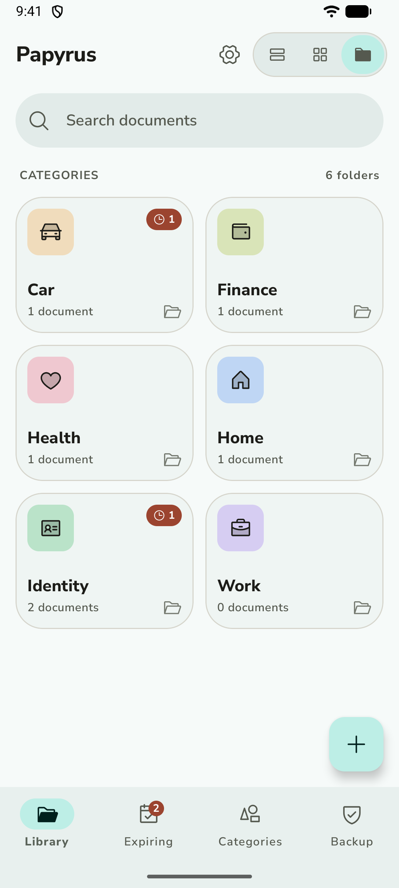
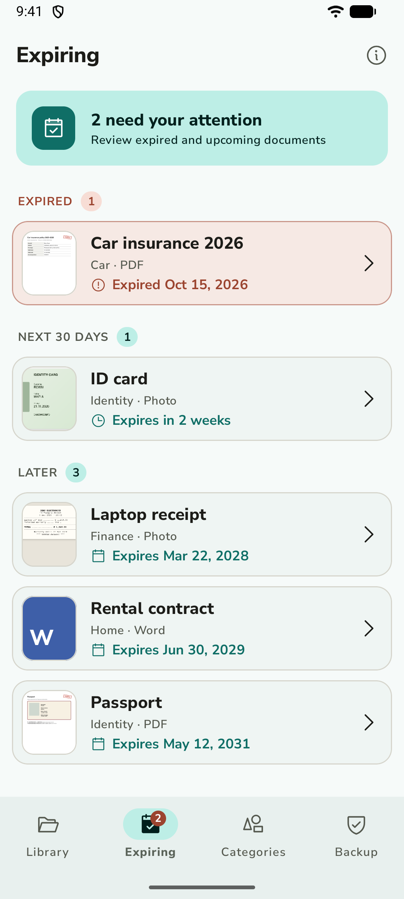
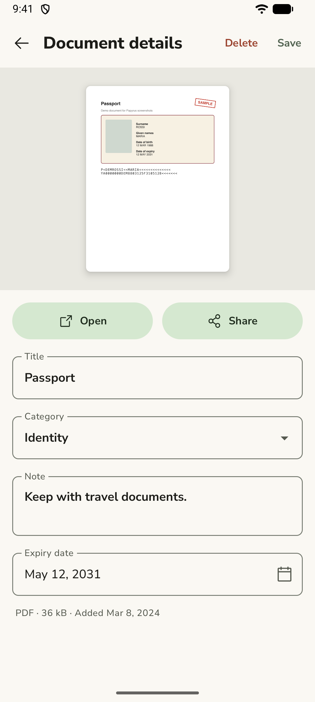
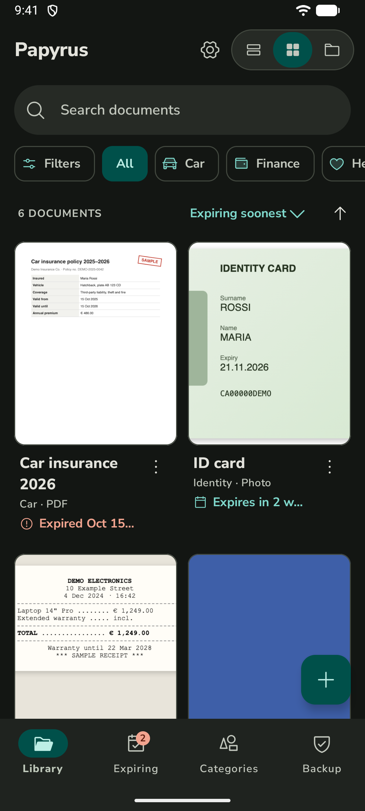

<p align="center">
  
</p>

<h1 align="center">Papyrus</h1>

<p align="center">Your personal documents, organized and private. Fully offline.</p>

<p align="center">
  
  
  
  
</p>

Papyrus is a free, open-source Android app that keeps your important documents in one tidy
place: ID cards, passports, insurance policies, medical tests, contracts, receipts and warranties.

## Private by design

- **Everything stays on your phone.** No account, no cloud, no ads, no tracking.
- **No permissions.** Papyrus can't access the internet or your storage. It only sees the files
  you pick in the system file picker, and it hands a single file to another app only when you
  tap Open or Share.

## Features

- Add PDFs, Word files and photos (they're copied into the app, so they survive if the original is deleted;
  Papyrus then offers to delete the originals to free up space)
- Scan paper documents with the camera into a multi-page PDF, with crop to the paper's corners and rotation
- Share files to Papyrus from any app
- Categories with 32 icons to choose from; browse them as folders, or as chips above a list or grid
- Notes and expiry dates; the **Expiring** tab shows what has expired or expires within 30 days
- Search titles, notes and categories (case and accents ignored), filter by type and date added,
  sort by date, title or expiry in either direction
- Previews of PDF pages and photos; list, grid or folders view
- Open and share documents with other apps
- Backup and restore the whole library as one ZIP file
- Light and dark theme, three color palettes (Teal, Sage, Sun) and four text sizes; English and Italian;
  report a bug or request a feature from Settings

### About backups

A backup is a normal ZIP file (`manifest.json` plus your files) saved wherever you choose. You can
open it on a computer without Papyrus. **It isn't encrypted**, so keep it somewhere safe.

## Install

Download the latest `papyrus-x.y.z.apk` from [Releases](https://github.com/AndreaRandazzo/papyrus/releases)
and open it on your phone (Android 8.0 or newer). Android will ask you to allow installing apps
from your browser or file manager the first time.

To get updates automatically, you can track this repository with
[Obtainium](https://github.com/ImranR98/Obtainium), a free app that installs releases straight from GitHub.

## Build from source

Requirements: Android Studio, or JDK 17+ and the Android SDK.

```sh
./gradlew assembleDebug       # debug build: app/build/outputs/apk/debug/
./gradlew testDebugUnitTest   # unit tests
./gradlew assembleRelease     # release build (unsigned unless ~/.papyrus/keystore.properties exists)
```

Built with Kotlin, Jetpack Compose (Material 3) and Room.

## Translations

Texts live in `app/src/main/res/values/strings.xml` (English) and `values-it/` (Italian).
To add a language, copy `strings.xml` into `values-xx/`, translate it, and add the language code
to `localeFilters` in `app/build.gradle.kts`. Contributions are welcome.

## License

Papyrus is licensed under the [GNU General Public License v3.0](LICENSE).

Third-party assets:
- [Phosphor Icons](https://phosphoricons.com), MIT License ([licenses/Phosphor-MIT.txt](licenses/Phosphor-MIT.txt))
- [Nunito Sans](https://github.com/Fonthausen/NunitoSans), SIL Open Font License 1.1 ([licenses/NunitoSans-OFL.txt](licenses/NunitoSans-OFL.txt))

The documents in the screenshots are fictional samples.
