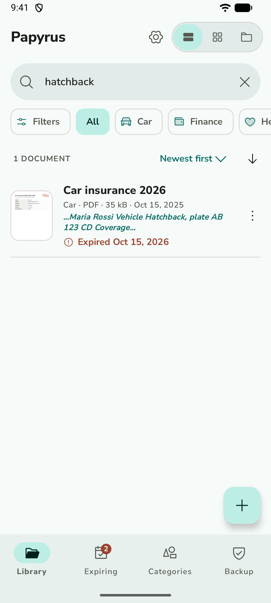
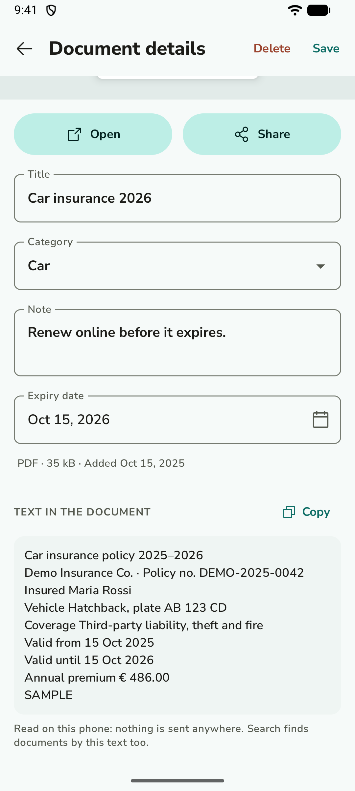

<p align="center">
  
</p>

<h1 align="center">Papyrus</h1>

<p align="center">Your personal documents, organized and private. Fully offline.</p>

<p align="center">
  
  
  
  
</p>

Papyrus is a free, open-source Android app that keeps your important documents in one tidy
place: ID cards, passports, insurance policies, medical tests, contracts, receipts and warranties.

## Private by design

- **Everything stays on your phone.** No account, no cloud, no ads, no tracking.
- **No internet, no storage access.** Papyrus has no internet permission and can't read your
  storage. It only sees the files you pick in the system file picker, and it hands a single file
  to another app only when you tap Open or Share. Its only permissions serve optional features:
  `USE_BIOMETRIC` shows Android's fingerprint / face prompt for the app lock (granted without
  asking); `POST_NOTIFICATIONS` (asked only when you turn expiry reminders on) and
  `RECEIVE_BOOT_COMPLETED` (to set the daily reminder check again after a restart).

## Features

- Add PDFs, Word files and photos (they're copied into the app, so they survive if the original is deleted;
  Papyrus then offers to delete the originals to free up space)
- Scan paper documents with the camera into a multi-page PDF, with crop to the paper's corners and rotation
- Share files to Papyrus from any app
- Categories with 32 icons to choose from; browse them as folders, or as chips above a list or grid
- Optional app lock with your fingerprint, face or phone PIN; the recent-apps screen shows a blank card
- Notes and expiry dates; the **Expiring** tab shows what has expired or expires within 30 days
- Optional expiry reminders: a notification 30 and 7 days before and on the day
- Search titles, notes, categories and the text inside documents (case and accents ignored), filter by type and date added,
  sort by date, title or expiry in either direction
- Reads the text inside documents on the phone: from PDFs directly, from photos and scans with on-device
  text recognition (Italian and English). Nothing is sent anywhere
- Previews of PDF pages and photos; list, grid or folders view
- Open and share documents with other apps
- Backup and restore the whole library as one file, optionally protected with a password
- Light and dark theme, three color palettes (Teal, Sage, Sun) and four text sizes; English and Italian;
  report a bug or request a feature from Settings

### About backups

A backup is one file (`manifest.json` plus your files in a ZIP) saved wherever you choose.

- **With a password** (`.papyrus` file): the ZIP is encrypted with AES-256-GCM, in 64 KB chunks
  that are each authenticated, so any change or cut-off is detected. The key comes from the password
  through PBKDF2-HMAC-SHA256 with 600,000 rounds and a random salt. Nothing else is needed to restore
  it but the password, and **a forgotten password can't be recovered**.
- **Without a password** (`.zip` file): a normal ZIP you can open on a computer without Papyrus.
  It isn't encrypted, so keep it somewhere safe.

The recognized text of documents isn't included; it's read again after a restore.

## Install

Download the latest `papyrus-x.y.z.apk` from [Releases](https://github.com/AndreaRandazzo/papyrus/releases)
and open it on your phone (Android 8.0 or newer). Android will ask you to allow installing apps
from your browser or file manager the first time.

To get updates automatically, you can track this repository with
[Obtainium](https://github.com/ImranR98/Obtainium), a free app that installs releases straight from GitHub.

## Build from source

Requirements: Android Studio, or JDK 17+ and the Android SDK.

```sh
./gradlew assembleDebug       # debug build: app/build/outputs/apk/debug/
./gradlew testDebugUnitTest   # unit tests
./gradlew assembleRelease     # release build (unsigned unless ~/.papyrus/keystore.properties exists)
```

Built with Kotlin, Jetpack Compose (Material 3) and Room.

## Translations

Texts live in `app/src/main/res/values/strings.xml` (English) and `values-it/` (Italian).
To add a language, copy `strings.xml` into `values-xx/`, translate it, and add the language code
to `localeFilters` in `app/build.gradle.kts`. Contributions are welcome.

## License

Papyrus is licensed under the [GNU General Public License v3.0](LICENSE).

Third-party assets:
- [Phosphor Icons](https://phosphoricons.com), MIT License ([licenses/Phosphor-MIT.txt](licenses/Phosphor-MIT.txt))
- [Nunito Sans](https://github.com/Fonthausen/NunitoSans), SIL Open Font License 1.1 ([licenses/NunitoSans-OFL.txt](licenses/NunitoSans-OFL.txt))
- Text recognition: [Tesseract](https://github.com/tesseract-ocr/tesseract) via [Tesseract4Android](https://github.com/adaptech-cz/Tesseract4Android), Apache License 2.0 ([licenses/Tesseract-Apache-2.0.txt](licenses/Tesseract-Apache-2.0.txt), [licenses/Tesseract4Android-Apache-2.0.txt](licenses/Tesseract4Android-Apache-2.0.txt)), with [Leptonica](http://leptonica.org) (BSD 2-Clause, [licenses/Leptonica-BSD-2-Clause.txt](licenses/Leptonica-BSD-2-Clause.txt)), [libjpeg](https://ijg.org) ([licenses/libjpeg-IJG.txt](licenses/libjpeg-IJG.txt)) and [libpng](http://libpng.org) ([licenses/libpng-License.txt](licenses/libpng-License.txt))
- Italian and English text models: [tessdata_fast](https://github.com/tesseract-ocr/tessdata_fast), Apache License 2.0

The documents in the screenshots are fictional samples.
